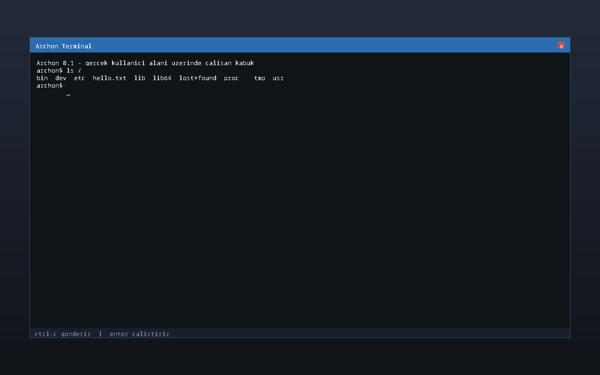

# Archon

A bare-metal x86_64 kernel for running Arch Linux userland without modification.

---

## Overview / Genel Bakış

Archon is a minimalist, Rust-based kernel designed to run Arch Linux userland on bare metal. It implements the essential components needed to run a modern Linux desktop environment while maintaining a minimal footprint. AI usage was kept to a minimum (around 5%); everything else is hand-written.

Archon, Arch Linux userland'ını bare-metal üzerinde çalıştırmak için tasarlanmış minimalist, Rust tabanlı bir kerneledir. Modern bir Linux masaüstü ortamını çalıştırmak için gerekli temel bileşenleri uygularken minimal bir ayak izi korur. AI kullanımı en aza indirildi (yaklaşık %5); gerisi elle yazıldı.

---

## Key Features / Temel Özellikler

- ✅ Limine boot protocol support
- ✅ Rust, no_std, and no libc
- ✅ Arch Linux userland compatibility (no recompilation needed)
- ✅ Preemptive round-robin scheduling
- ✅ Basic memory management with bitmap allocator
- ✅ Virtual memory and page tables
- ✅ Process and thread management
- ✅ System call implementation
- ✅ VirtIO-blk storage support
- ✅ ext4 read support
- ✅ Framebuffer (`/dev/fb0`) and evdev input (`/dev/input/event0`); SDL2/SDL3 demo programs run in userland
- ✅ GUI framebuffer capabilities (kernel-side terminal, window drawing)
- ✅ ELF64 loader with PT_INTERP and full auxv
- ✅ Signal delivery with EINTR semantics
- ✅ Process groups, job control (Ctrl-C, Ctrl-Z, fg, bg)
- ✅ epoll, eventfd, timerfd, memfd, socketpair, O_NONBLOCK
- ✅ Pseudo terminal device (/dev/ptmx, /dev/pts/0)
- ✅ Real PS/2 keyboard support via evdev
- ✅ Serial console (COM1, 115200 8N1)
- ✅ ACPI and PCI enumeration

- ✅ Limine önyükleme protokolü desteği
- ✅ Rust, no_std, libc yok
- ✅ Arch Linux userland uyumluluğu (yeniden derleme gerekmez)
- ✅ Preemptive round-robin zamanlayıcı
- ✅ Bitmap ayırıcı ile temel bellek yönetimi
- ✅ Sanal bellek ve sayfa tabloları
- ✅ Süreç ve iş parçacığı yönetimi
- ✅ Sistem çağrısı uygulaması
- ✅ VirtIO-blk depolama desteği
- ✅ ext4 okuma desteği
- ✅ Framebuffer (`/dev/fb0`) ve evdev girişi (`/dev/input/event0`); SDL2/SDL3 demo programları userland'da çalışır
- ✅ GUI framebuffer yetenekleri (çekirdek tarafı uçbirim, pencere çizimi)
- ✅ PT_INTERP ve tam auxv ile ELF64 yükleyici
- ✅ EINTR semantiği ile sinyal teslimi
- ✅ Süreç grupları, iş kontrolü (Ctrl-C, Ctrl-Z, fg, bg)
- ✅ epoll, eventfd, timerfd, memfd, socketpair, O_NONBLOCK
- ✅ Sözde uçbirim cihazı (/dev/ptmx, /dev/pts/0)
- ✅ evdev arayüzü üzerinden gerçek PS/2 klavye desteği
- ✅ Seri konsol (COM1, 115200 8N1)
- ✅ ACPI ve PCI numaralandırması

---

## Current Status / Mevcut Durum

| Component / Bileşen | Status / Durum |
|---------------------|----------------|
| Boot & Kernel / Önyükleme ve Kernel | ✅ |
| Memory Management / Bellek Yönetimi | ✅ |
| Processes & Threads / Süreçler ve İş Parçacıkları | ✅ |
| System Calls / Sistem Çağrıları | ✅ |
| Storage (ext4 read) / Depolama (ext4 okuma) | ✅ |
| Graphics (framebuffer) / Grafik (framebuffer) | ✅ |
| Input (evdev) / Giriş (evdev) | ✅ |
| GUI Framebuffer / GUI Framebuffer | ✅ |
| Networking / Ağ | ⬜ |
| DRM/KMS | ⬜ |
| Wayland | ⬜ |
| ext4 write / ext4 yazma | ⬜ |

---

## Screenshots / Ekran Görüntüleri

| Kernel-side GUI terminal / Uçbirim GUI'si (çekirdek tarafı) | SDL2 demo over evdev, userland / evdev üzerinden SDL2 demosu (userland) |
|---|---|
|  |  |

---

## Build Instructions / Derleme Talimatları

### 1. Install dependencies / Bağımlılıkları kurun

```bash
# Arch / CachyOS
sudo pacman -S --needed make python3 e2fsprogs xorriso binutils rustup qemu-desktop

# Nightly toolchain is pinned by rust-toolchain.toml;
# rustup installs it automatically on first build.
```

```bash
make deps      # Generates limine_ids.rs from the vendored Limine header / Vendored Limine başlığından limine_ids.rs üretir
               # Fresh clone? Limine lives under vendor/limine and is not in the repo:
               # `make limine-download LIMINE_VERSION=vX.Y` / Yeni klon? vendor/limine repoda yok, limine'i önce indirin
make           # Builds the kernel and bootable ISO / Kernel ve önyüklenebilir ISO derlenir
```

### 2. Run headless (serial log) / Başlıksız çalıştır (seri kayıt)

```bash
make run       # QEMU without a display; COM1 output goes to build/serial.log
               # and is printed when QEMU exits. / Ekransız QEMU; COM1 çıktısı
               # build/serial.log'a yazılır ve QEMU çıkınca basılır.
```

### 3. Run with GUI (framebuffer window) / GUI ile çalıştır (framebuffer penceresi)

```bash
make run-gui
```

### 4. Build ring-3 test programs / Ring-3 test programlarını derle

```bash
make user      # init, hello, forktest
```

### 5. Build ext4 test image / ext4 test imajını oluştur

```bash
make disk      # 64 MiB ext4 image via mke2fs / mke2fs ile 64 MiB ext4 imajı
```

---

## Documentation / Dokümantasyon

- [ROADMAP.md](ROADMAP.md) - Milestone-based development plan / Aşama bazlı gelişim planı
- [ARCHITECTURE.md](docs/ARCHITECTURE.md) - Technical architecture details / Teknik mimari detayları
- [SYSCALLS.md](docs/SYSCALLS.md) - System call reference / Sistem çağrısı referansı
- [DEMOS.md](docs/DEMOS.md) - Graphics demos / Grafik demoları
- [KDE-PLAN.md](docs/KDE-PLAN.md) - KDE bring-up plan / KDE çalıştırma planı

---

## Hardware Support / Donanım Desteği

- QEMU (x86_64, q35 machine) / QEMU (x86_64, q35 makinesi)
- KVM acceleration when available (`/dev/kvm`), TCG fallback / KVM hızlandırması mevcutsa (`/dev/kvm`), yoksa TCG
- VirtIO-blk virtual disk / VirtIO-blk sanal disk
- VirtIO-GPU groundwork present; full display driver planned for the DRM/KMS milestone / VirtIO-GPU temeli hazır; tam görüntü sürücüsü DRM/KMS aşaması için planlandı
- PS/2 keyboard / PS/2 klavye

---

## Build Configuration / Derleme Yapılandırması

Default build settings / Varsayılan derleme ayarları:
- Target / Hedef: `x86_64-unknown-none` (nightly)
- Code model / Kod modeli: kernel (high half / yüksek yarım)
- Relocation model / Taşıma modeli: static
- Kernel linker script / Kernel bağlayıcı betiği: `kernel/linker.ld`
- QEMU memory / QEMU belleği: 2 GB
- SMP: 1 processor / 1 işlemci
- CPU: host

QEMU runs with `-cpu host`, and Arch/CachyOS userland packages assume x86-64-v3 (AVX2). The host CPU must therefore support AVX2; the default `qemu64` model does not.

QEMU `-cpu host` ile çalışır ve Arch/CachyOS userland paketleri x86-64-v3 (AVX2) varsayar. Bu yüzden ana işlemcinin AVX2 desteği gerekir; varsayılan `qemu64` modelinde AVX yoktur.

---

## License / Lisans

MIT License / MIT Lisansı
